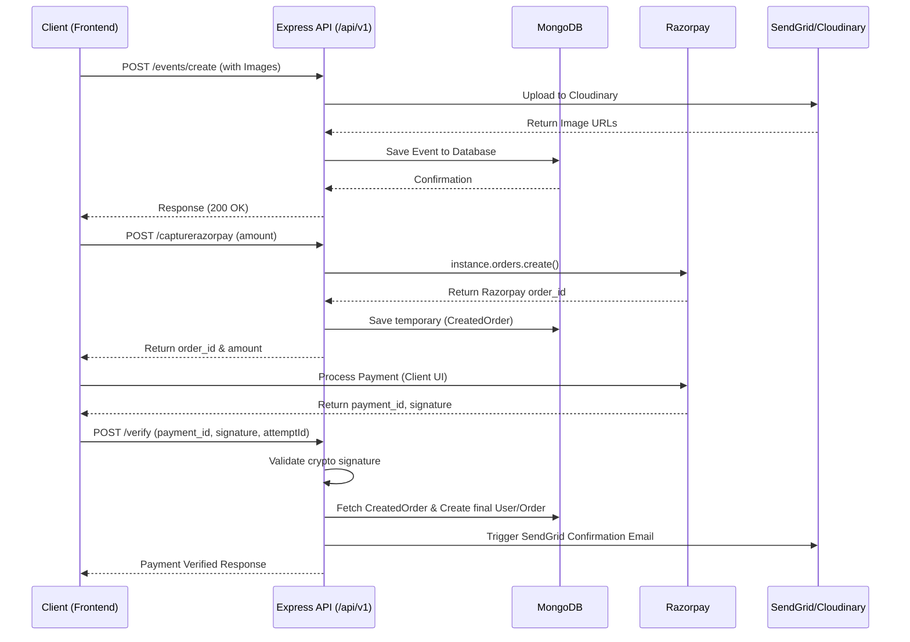

# Invento '23 Backend API

The official backend API for **Invento 2023**, the annual tech fest of Government Engineering College Palakkad. This RESTful API handles event registrations, user management, the Campus Ambassador program, payment processing via Razorpay, and automated email confirmations.

## 🚀 Tech Stack

- **Runtime Environment:** Node.js
- **Framework:** Express.js (v4.18)
- **Database:** MongoDB via Mongoose (v7.1)
- **Payment Gateway:** Razorpay (v2.8)
- **Image Storage:** Cloudinary (v1.36)
- **Email Services:** SendGrid (v7.7) & Nodemailer (v6.9)
- **Upload Management:** Multer
- **Data Validation:** Joi (v17.9)
- **Security:** Helmet, express-rate-limit, CORS

## 🏗️ Architecture Flow



## 🗄️ Core Data Models

- **`User`**: Stores participant details (name, email, phone, college) and their registered `events`. Generated post successful checkout.
- **`Event`**: Detailed event catalogs including `regFee`, images (stored on Cloudinary), rules, `maxParticipants`, and categorizations (e.g., Saptha, Proshow, Tech workshops).
- **`Order`**: A confirmed transaction record mapping event selections (`orderedEvents` & `orderedProshow`) to users, keeping track of proof/payment IDs and referral validations.
- **`CreatedOrder`**: Tracks mid-flight Razorpay intent metadata (attempt IDs vs generated Razorpay order IDs) before the final signature verification.
- **`CampusAmbassador`**: Manages the CA program, storing ambassador points, referral codes, and associated leads to distribute perks appropriately.

## 🌐 API Reference

**Base Path:** `/api/v1`
*(Note: Routes are rate-limited to 100 requests per IP / 15 mins)*

### Users
- `GET /users` - Retrieve all users.

### Events
- `GET /events/:category?` - Retrieve events (optional filter by category).
- `GET /events/:id` - Fetch details for a specific event.
- `POST /events/create` - Create a new event (Accepts `multipart/form-data` with images).
- `POST /events/update` - Update text fields for an event.
- `POST /events/updatephoto` - Update media mapped to an event.

### Orders
- `POST /order/create` - Submit formal application, subjected to Joi validation schemas.
- `GET /orders` - Fetch all general orders.
- `GET /orders/unverified` - Filter manually unverified orders.
- `POST /orders/verify` - Manually verify physical or fallback transfers.
- `POST /orders/proshow/verify` - Verify proshow-specific tickets.
- `GET /orders/verified/:id` - Get verified list per event.
- `GET /orders/:id` - Contextual event orders extraction.

### Payments
- `POST /capturerazorpay` - Initiate a Razorpay payment order.
- `POST /verify` - Perform signature validation and finalize purchase.

### Campus Ambassadors
- `GET /ambassadors` - List all CA records.
- `POST /ambassadors/create` - Register a new campus ambassador profile.

## ⚙️ Environment Variables Template (`.env.example`)

To run this project locally, create a `.env` file in the root directory and add the following keys. 

```env
# Application 
PORT=4000
NODE_ENV=development

# MongoDB
DB_URI=mongodb+srv://<username>:<password>@cluster.mongodb.net/invento23?retryWrites=true&w=majority

# Razorpay Keys
RAZORPAY_API_KEY=rzp_test_xxxxxx
RAZORPAY_SECRET=xxxxxxxxxxxxxxxxxxxx
RAZORPAY_API_SECRET=xxxxxxxxxxxxxxxxxxxx

# Cloudinary - For Image Uploads
CLOUDINARY_NAME=your_cloud_name
CLOUDINARY_API_KEY=00000000000000
CLOUDINARY_API_SECRET=xxxxxxxxxxxxxxxxxxxx

# SendGrid Email
SENDGRID_API_KEY=SG.xxxxxxxxxxxxxxxxxxxx
```

## 🛠️ Local Development Setup

1. **Clone the repository:**
   ```bash
   git clone <repository-url>
   cd invento23-backend
   ```
2. **Install dependencies:**
   ```bash
   npm install
   ```
3. **Set up Environment Variables:**
   Duplicate the provided `.env.example` file (or paste its contents) into a new `.env` file at the root namespace. Ensure all access keys are filled correctly.
4. **Start the Application:**
   ```bash
   # Standard node start
   npm start
   ```
   The server will start on the port defined in your `.env`.
